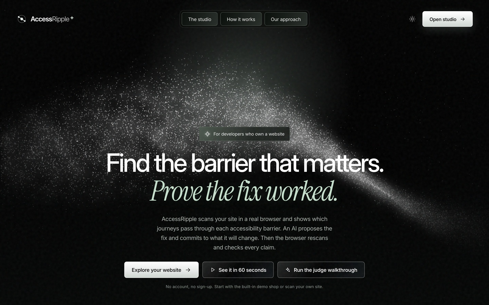
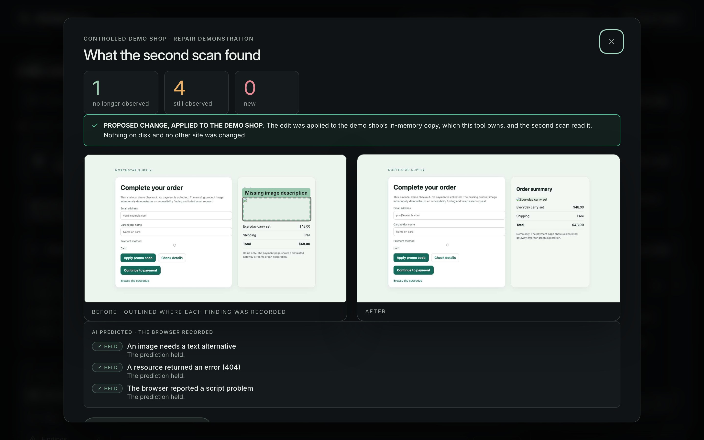
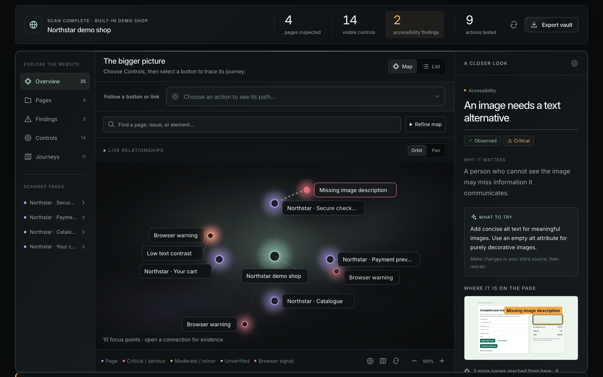
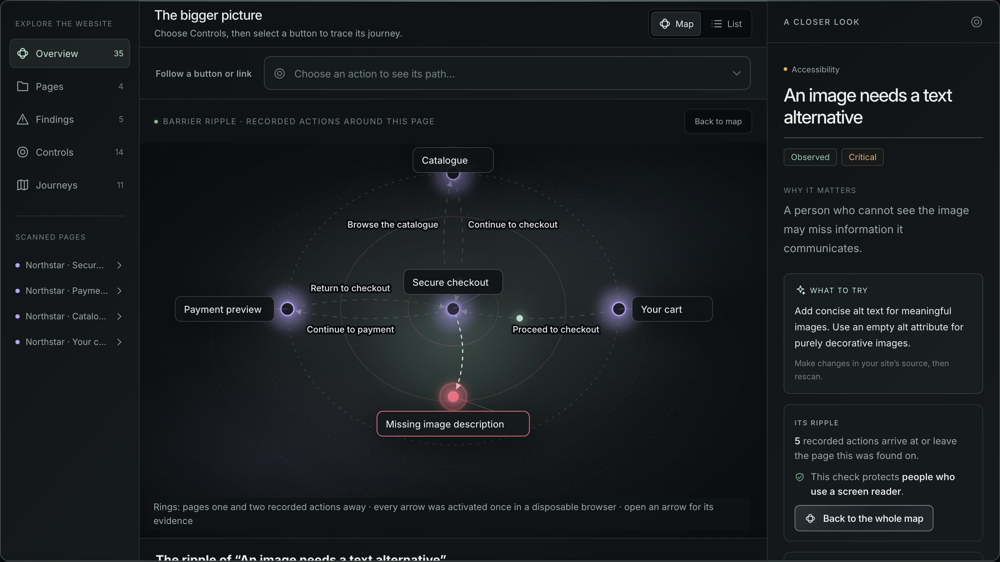
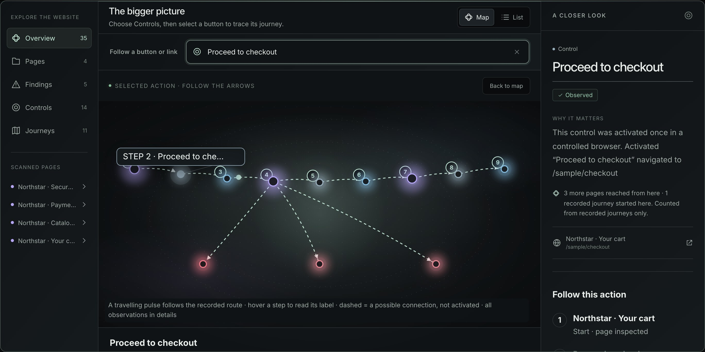
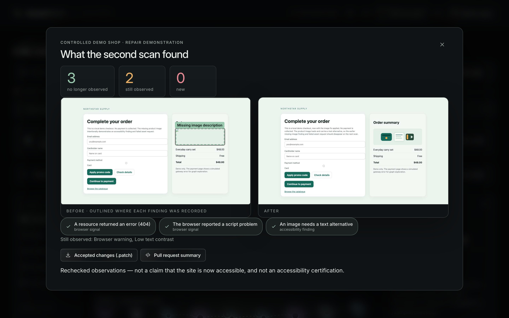
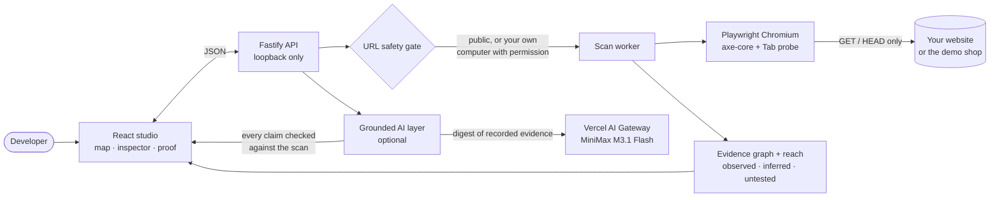
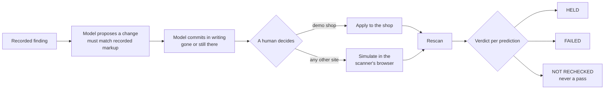
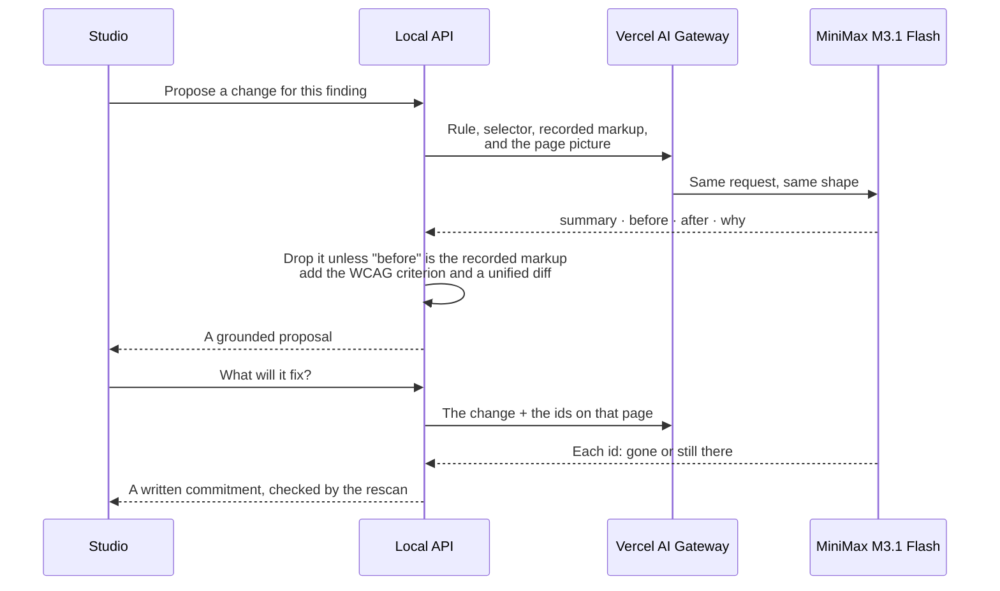

<div align="center">

# AccessRipple

### An AI that has to prove its accessibility fix — checked by a real browser.

A list tells you what failed. **AccessRipple shows where each barrier sits on the journeys people actually take, lets a model propose the fix, makes the model commit in writing to what that fix will do, and then rescans to check every claim.**

[](LICENSE)


[](https://learn-ai-basics.devpost.com/)

[**Open the live demo**](https://accessripple.tail601a7c.ts.net/) · [**Run the judge walkthrough**](https://accessripple.tail601a7c.ts.net/#walkthrough) · [**▶ Watch the demo video**](https://youtu.be/Uzcq7tJ8JL0) ·
[**Try it in one press**](#-for-judges-the-whole-idea-in-one-press) · [Architecture](docs/ARCHITECTURE.md) · [Scope](devpost/scope.md) · [PRD](devpost/prd.md) · [Spec](devpost/spec.md)



</div>

## ▶ For judges: the whole idea in one press

**[Run the hosted walkthrough](https://accessripple.tail601a7c.ts.net/#walkthrough)** — no installation or account required. The shared demo is hosted on Home PC through Tailscale Funnel. Scan history and demo-shop changes are visible to other visitors; use public URLs only. See [hosting and operation](docs/DEPLOYMENT.md).

Open **https://accessripple.tail601a7c.ts.net/#walkthrough**, or press **Run the judge walkthrough** on the landing page. No account, key or installation is needed. To run your own copy instead, see [Quick start](#quick-start).

| # | What happens on screen | What it shows |
| --- | --- | --- |
| 1 | A real Chromium browser scans a four-page demo shop and presses its safe buttons | Evidence, not guesses: every point is *observed*, *inferred* or *not tested* |
| 2 | The finding with the most recorded journeys through its page opens, with its **ripple** on the map | Which barrier to fix first, and where it sits on real journeys |
| 3 | A model proposes the smallest change, grounded in the exact markup the browser recorded | The AI works from evidence and cannot invent an element |
| 4 | The model **commits in writing**: "this finding will be gone, those two will still be there" | The AI's claim is on the record *before* anything changes |
| 5 | The change is applied to the demo shop, the same pages are rescanned, and the proof opens | Each prediction comes back **held**, **failed** or **unknown** — never silently passed |



On this computer the walkthrough runs in about 12 seconds without a model (it was 22 before the demo shop's interaction wait was shortened); the panel shows the measured time on yours. With no model configured — or if the model is busy — the demo shop's prepared fix stands in, and the panel says so.

## The problem

Accessibility checkers hand a developer a flat list of failures. The list cannot say **which barrier matters most**, **which journeys pass through it**, or **whether a fix actually worked**. AI repair tools make the last part worse: they write plausible fixes and declare success without ever checking.

About one in six people lives with a significant disability ([WHO](https://www.who.int/news-room/fact-sheets/detail/disability-and-health)). For them, a missing image description or a keyboard trap on a checkout page is the difference between buying and leaving.

## What makes it different

| | A typical checker | A typical AI fixer | **AccessRipple** |
| --- | --- | --- | --- |
| Finds barriers in a real browser | ✓ | sometimes | ✓ axe-core + a Tab-key probe |
| Knows which journeys pass through a barrier | — | — | ✓ recorded by pressing the buttons |
| Proposes a concrete fix | — | ✓ | ✓ grounded in the recorded markup, with a WCAG criterion and a diff |
| States in advance what the fix will change | — | — | ✓ a written, checkable commitment |
| Checks the fix by measuring again | — | — | ✓ rescan → held / failed / unknown |
| Admits what it did not check | — | — | ✓ coverage gaps and "not rechecked" are first-class |

## Who it is for

Front-end developers and small teams who own a website — a shop, a portfolio, a product site, a project on GitHub Pages or on `localhost` — and need to decide what to fix first, then prove the fix landed.

## What AccessRipple does

1. **Opens your site in a real browser.** Playwright Chromium crawls up to five same-site pages, runs axe-core on each, and presses Tab through each page to catch keyboard traps and invisible focus.
2. **Presses the buttons, safely.** Ordinary buttons and links are activated once each in disposable pages, and what actually happened is recorded. Requests that would change data are blocked; pay, delete, send and sign out are never pressed.
3. **Draws one evidence map.** Pages, controls, recorded journeys, browser errors and accessibility findings become one spatial graph you can explore with a mouse or entirely from the keyboard.
4. **Shows a barrier's ripple and reach.** Select a finding to see the pages one and two recorded actions away, and how many journeys pass through its page. These are counts, never a made-up score, and the tool never claims a barrier *stops* a journey.
5. **Puts the AI on trial.** A model proposes a change grounded in the recorded markup and the page screenshot, commits **in writing** to what it will fix, a human applies it, and the rescan reports each prediction as **held**, **failed** or **not rechecked**. On any live site the change is *simulated* inside the scanner's own browser — the site is never touched, and the result is labelled **SIMULATED PATCH**.
6. **Hands over the result.** Download every accepted change as a `.patch` and a pull request summary, reopen recent scans after a restart, or export the whole graph as a linked Obsidian vault.

## See it

| The map of a scanned site | A barrier's ripple |
| --- | --- |
|  |  |
| **A recorded journey, step by step** | **The proof: before, after, and the model's predictions checked** |
|  |  |

## How it works





The full picture — the scan sequence, the graph model, the safety boundaries and where each piece lives in the code — is in **[docs/ARCHITECTURE.md](docs/ARCHITECTURE.md)**.

## How it answers the judging criteria

| Criterion | Where to look |
| --- | --- |
| **Design** | One coherent loop — scan → evidence → fix → commitment → rescan → verdict → export. A finished scan fits one 1440 × 900 screen; the map works by keyboard, a live region announces progress and verdicts, badges never rely on colour alone, and reduced motion is respected. |
| **Potential impact** | A developer can trace a button to the page with a barrier, fix the one with the widest reach first, and hand over a `.patch` and a pull request summary. It works on public sites, on `localhost`, and on GitHub Pages. |
| **Innovation** | The model's *pre-registered* prediction, checked by a real browser and reported as held, failed or unknown — plus a ripple and reach computed only from journeys the browser actually took. |
| **Presentation** | The one-press walkthrough above, a guided tour whose steps double as captions. |

**Honest limits.** Automated checks catch a useful subset of barriers; they do not certify accessibility, and the studio says so on every result. A model's citation is checked to point at real evidence, not to be true of it. A simulated patch tests the change in the scanner's browser, not on the live site.

## Quick start

Requirements: Node.js 22 and npm.

```sh
npm install
npx playwright install chromium
npm run demo
```

`npm run demo` starts the app and opens the studio straight into a scan of the built-in demo shop. It takes about six seconds, needs no internet connection, and always produces the same result.

**The core demo needs no account, no key and no network.** The optional AI briefing, the proposed change and the model's commitment need a [Vercel AI Gateway](https://vercel.com/ai-gateway) key in `.env` (see [below](#optional-ai-briefing-and-proposed-changes)). Without one the app is still complete: it says so where the button would be, and shows the deterministic summary instead.

If `npm run demo` does not open, start the two servers yourself and open `http://127.0.0.1:5173/`:

```sh
npm run dev
```

The scanner also serves the built studio itself once you have run `npm run build`, so `npm start` gives a working application on `http://127.0.0.1:4317/`.

### A tour of the studio

Open `http://127.0.0.1:5173/` and choose **Explore your website**. Enter a public website address, map it, and select a point for its impact and suggested next step. Use **List** for every recorded element, **Rescan and compare** after making your own source changes, and **Export vault** to save linked notes and the raw graph. Before mapping, you can tick **Test form and submit controls too** to let the scanner activate submit controls as well; requests that would send or change data stay blocked either way. Choose **Scan the demo shop** to run the built-in fixture instead, press **See it in 60 seconds** on the landing page to open the studio straight into that scan, or press **Judge walkthrough** to run the whole repair loop in one go.

The **▶ guided tour** in the studio header walks the core journey one step at a time. Each step shows the sentence to say out loud, moves the interface to the place the narration is talking about, and advances when you perform the action. It doubles as the on-screen captions for a recorded demo, so a muted recording still explains itself.

A finished scan scrolls itself so the metrics, the whole map and the inspector share one screen. The decorative animation and fonts are served locally. The animation can be paused and starts paused when reduced motion is requested. The latest scan identifier is retained in this tab’s session so a reload can reconnect, and completed scans are kept on this computer so they can be reopened from **Recent scans** after the scanner restarts. No sample graph is seeded into the interface.

## In depth

### The ripple of a barrier

Every accessibility finding has a **ripple**. **See its ripple on the map** puts the page the barrier was found on in the middle and arranges the pages one and two recorded actions away on rings around it. Each arrow is named after the control the browser activated and opens its evidence, both directions of a loop are drawn, and a link the browser never activated is left out. The inspector says who the check protects, in the words of the rule behind it. The ripple places a barrier on real journeys; it never claims a barrier stops one. **A good place to start** orders findings by severity, then by how many recorded actions pass through the finding's page, then by how many elements are affected, and each card shows those three facts instead of a score.

Every result also explains its coverage — pages inspected, destinations not reached, and controls left untested, each with a reason — and completed scans are saved on this computer so **Recent scans** survives a restart of the scanner.

### Observed interactions

The studio tests a bounded set of safe controls once each in disposable browser pages and records what actually happened: navigation, content changes, dialogs, validation, loading states, blocked requests, and failures. Observed outcomes replace inference for those controls, and a selected action shows its recorded route across independently inspected pages with an animated pulse along the way. Form and submit controls wait for explicit permission, requests that would change data are always blocked and recorded, and consequential actions such as delete, send, or pay are never activated. A controlled checkout fixture in the backend demonstrates the whole chain (catalogue → cart → checkout → payment); it never sends a payment or collects data.

### Your own sites

Any public website can be scanned, including one of your own: a GitHub Pages site, a personal domain, or a project you have published. Type the address with or without `https://` and press **Map this website**.

A page that redirects is followed only within the website being scanned. The scanner fetches each page without following redirects and checks the target before the browser is allowed to go, so a redirect cannot carry the scan to another server.

A site running on your own machine is a different matter. Private and reserved addresses are refused by default, because a scanner that can reach `localhost` can reach anything your computer can. Tick **Scan an address on my own computer** under the URL field to open an address on your own machine — `http://localhost:5173`, a private network address such as `http://192.168.1.20:8080`, or any custom port. The permission is explicit, it applies to that scan and to its rescan, and the result is marked **ADDRESS ON THIS COMPUTER** so nobody mistakes it for a public site. The cloud credential addresses (`169.254.169.254` and `metadata.google.internal`) are refused whether the box is ticked or not.

### The demo shop

A built-in four-page checkout fixture is available directly in the studio. **Scan the demo shop** opens it in a real browser, always from its broken state, so the result is the same on every run and needs no internet connection. The limit of five new scans a minute protects other people's websites, so it does not apply to the demo shop: a rehearsal can scan it as often as it needs to. Any change accepted earlier is dropped first, so a second take starts where the first one did. **Prove a repair** switches the same fixture between its broken and repaired states and rescans, so the before-and-after comparison happens in the interface. **Show the proof** then shows the same page before and after, side by side, with the counts. The landing page's **See it in 60 seconds** opens the studio straight into that scan. A guide in the studio header lists the beats of a three-minute recording.

`npm run prepare:demo` prepares this computer for a recorded demo: it clears the saved history, scans a set of well-known public sites, and leaves the demo shop in its broken state with the pair of scans that proves a repair.

### Optional AI briefing and proposed changes

The studio can also show a short, model-written read of a finished scan, and it can propose a concrete code change for a finding. Both are off by default, and the deterministic scan summary is always shown whether or not they are enabled.

To enable them, copy `.env.example` to `.env` and fill in a key:

```sh
cp .env.example .env
```

```sh
ACCESSRIPPLE_AI_KEY=your-ai-gateway-key
ACCESSRIPPLE_AI_BASE_URL=https://ai-gateway.vercel.sh/v1
ACCESSRIPPLE_AI_MODEL=minimax/minimax-m3.1-flash
ACCESSRIPPLE_AI_FALLBACK_MODELS=
ACCESSRIPPLE_AI_REASONING_EFFORT=low
```

Only the key is required (a [Vercel AI Gateway](https://vercel.com/ai-gateway) API key; `AI_GATEWAY_API_KEY` is read too); the other values shown are the defaults, and `.env.example` explains each one.

Requests go through the [Vercel AI Gateway](https://vercel.com/docs/ai-gateway), one OpenAI-compatible endpoint in front of many providers. The default model is MiniMax M3.1 Flash. Add more to `ACCESSRIPPLE_AI_FALLBACK_MODELS` to chain them, for example `deepseek/deepseek-v4.1-flash-1017`. Create a key under **AI Gateway → API Keys** in the Vercel dashboard and put it in `.env`; nothing else is needed. Each request asks for a low reasoning effort and a large token budget, because a reasoning model given a small budget can spend it all thinking and return no answer.



Any OpenAI-compatible chat-completions endpoint works, including a local one. `.env` stays on this computer and is ignored by git; restart the scanner after changing it. A single model can be busy or rate limited at any moment, so a chain of fallbacks is used: the models are tried in order and the first usable answer wins. If every model is busy, the studio says so in plain words and offers **Ask again** instead of a dead end.

Three rules keep the output honest, because an overconfident summary is worse than no summary.

1. The model only ever sees a compact digest of evidence the browser recorded, and is told that the evidence is data rather than instructions.
2. Every sentence must cite an evidence id that exists in the scan. Any sentence whose citations are all invalid is dropped, and if nothing survives the request fails and the studio keeps the deterministic summary. This checks that a citation points at something the browser really recorded. It does not check that the sentence is true of it, and the interface never claims it does.
3. The digest includes the coverage gaps, not only the findings, and the model is asked to name at least one thing the scan did not check. The gaps are listed under the summary whether or not the model chose to mention them, as dashed chips that are not links, because they describe what is missing rather than a piece of evidence.

A proposed change is grounded the same way: the model receives the failing rule, the CSS selector, the markup the browser recorded, and the picture of the page when there is one. The proposal is dropped unless it matches that markup. A model that refuses the picture is asked again with text only. Each proposal carries the WCAG success criterion, read from the check's own tags rather than from the model; the model's account of what a screen reader or keyboard user meets there, labelled as the model's; and the change as a unified diff built by the tool.

The tool proposes; it never edits a scanned website. On the built-in demo shop, which this tool owns, the same proposal can be applied so a rescan can prove whether it worked. On any other site, **Simulate on the next rescan** records the change, and the rescan applies it inside the scanner's own disposable browser before the checks run. It applies only if the element at that selector still has exactly the recorded markup, and otherwise says it was not applied. Every page checked this way is marked **SIMULATED PATCH**, and every verdict about it says it was checked on a simulated page. The site itself is never touched.

Every accepted change can be downloaded from the proof as one `.patch` file, or as a pull request summary that lists each change and the table of what the model committed to against what the browser recorded (`GET /api/applied-fixes/patch`, or `?format=markdown`).

### The model has to put its claim on trial

A suggested change is worth little on its own, because a model can write a plausible replacement for a missing image description without ever checking whether it works. So before the change is applied, the model is asked to commit **in writing** to what its change will and will not fix.

The browser then checks those commitments against the rescan. On the demo shop the model commits to three things: the missing description will be gone, the 404 will still be there, and the other 404 will still be there. The rescan checks all three, and the interface reports each one as held, failed, or unknown.

The rules keep this honest:

- The model may only predict about ids it was given, and only two answers are allowed: gone or still there.
- The finding the change targets must be covered, and at most two more may be predicted.
- A prediction is only checked when the page it is about was inspected again. A page whose accessibility checks could not run cannot prove anything, so it is reported as **not rechecked** and never counted as a pass.
- A prediction that failed is reported as failed. The tool does not hide the model's mistakes, because a tool that only shows successes is not telling you whether to trust it.

### Keyboard, reach, and the picture of a barrier

After the automated checks, the scanner presses Tab up to twelve times on each page and records where focus goes. Tab moves focus and activates nothing. Two things a static check cannot see are reported for a person to confirm: focus that goes round two elements and never leaves, on a page with more to reach (**keyboard trap**, 2.1.2), and a focused element that looks no different from an unfocused one (**focus not visible**, 2.4.7).

Every finding, control and page carries its **reach**, counted from observed movement only: how many pages the browser reached beyond it, and how many recorded journeys pass through its page. Hovering or focusing a point lights those up on the map. These are counts, never a score, and they never claim that a barrier stops a journey. A finding whose markup fails the same check on two or more pages is marked as a shared component, because it is fixed once.

Each finding also records where its element sat on the page. The inspector shows the page with that element outlined, and the proof outlines each finding on the before picture.

### Accessible to the people it is for

The map is a labelled region. On a point, the arrow keys move to the connected point that lies that way, Enter opens it, and focus moves to its details; Escape gives focus back to the map. Plus, minus and zero zoom and fit. One polite live region announces scan progress, a finished scan, a ready briefing, a proposal, the model's commitment, and the rescan's verdict. Every status and severity badge has a mark and a word as well as a colour. Dialogs trap focus natively and hand it back when they close.

### The judge walkthrough

**Judge walkthrough**, in the studio and on the landing page (`#walkthrough`), runs the whole argument in one press. It scans the demo shop, opens the finding with the most recorded journeys through its page, has the model propose a change and commit to its outcome, applies the change, rescans, and opens the proof. A panel shows each step and the time it took; without a model it took about 12 seconds on this computer. Without a configured model, or when the model is busy, the demo shop's prepared fix stands in and the panel says so.

### The API

```sh
npm run dev:api
```

Open `http://127.0.0.1:4317/docs` for the OpenAPI page. The sample lives at `http://127.0.0.1:4317/sample/checkout`.

Start a sample scan:

```sh
curl -X POST http://127.0.0.1:4317/api/scans \
  -H 'content-type: application/json' \
  -d '{"sample":"checkout"}'
```

Use the returned `scanId` with `GET /api/scans/{scanId}`, `/graph`, and `/export/obsidian`. `GET /api/sample/info` describes the demo shop, and `GET /api/sample/state` reports whether it is currently in its broken or repaired state.

The checkout sample ships in two states so you can demonstrate a real fix on a site you control:

```sh
# 1. Scan the broken state (the product image has no alternative text and 404s).
curl -X POST http://127.0.0.1:4317/api/sample/state -H 'content-type: application/json' -d '{"variant":"before"}'
curl -X POST http://127.0.0.1:4317/api/scans -H 'content-type: application/json' -d '{"sample":"checkout"}'

# 2. Apply the fixed state (product.svg with alternative text).
curl -X POST http://127.0.0.1:4317/api/sample/state -H 'content-type: application/json' -d '{"variant":"after"}'

# 3. Rescan the same scan and compare: the image finding and both 404 signals resolve.
curl -X POST http://127.0.0.1:4317/api/scans/{scanId}/rescan -H 'content-type: application/json' -d '{}'
curl http://127.0.0.1:4317/api/scans/{newScanId}/compare/{scanId}
```

In the studio the same loop works through **Rescan and compare** after toggling the state; set it back to `before` when finished.

### Scan boundaries

- The service binds to loopback and is intended for local development only.
- Scans are bounded to five same-origin pages, two links deep, with per-page and overall time limits. Interaction testing gets a fixed slice of the budget so a heavy site still reaches more than one page.
- A bounded set of safe controls (ordinary buttons and same-site links) is activated once each in disposable browser pages. Form and submit controls are activated only when the scan explicitly allows it; a tick-box in the studio records that permission, and without it the rescan keeps the previous choice.
- Data-changing requests (anything other than GET/HEAD) and navigations outside the scanned website are always blocked and recorded, even with permission. Consequential actions such as delete, remove, send, pay, or sign out are never activated.
- Outcomes are labeled observed only when the browser recorded them; link and form destinations that were never activated remain inferred or not tested. Errors are attributed to the action that ran when they occurred, and unrelated page warnings stay context.
- Some sites answer an automated browser with a challenge page instead of the site. Those are reported as refused rather than as inspected, and the studio says plainly that nothing on them could be inspected.
- Private and reserved network addresses are blocked by default. Tick **Scan an address on my own computer** to open an address on your own machine — `localhost`, a private network address, or a custom port — with your permission. The cloud credential addresses (`169.254.169.254` and `metadata.google.internal`) are refused either way. A scan of a private address is marked as such in the result. This local proof of concept is not a hardened public scanning service; do not expose it to the internet.
- Automated accessibility checks cover a useful subset of barriers; they do not certify accessibility or discover every bug.
- Completed scans are saved as JSON on this computer (the newest 25, under `.data/`) so history survives restarts; delete that folder to clear the history. Export a vault to keep a portable copy.

## Verification

```sh
npm test               # 231 unit, API and end-to-end tests, including real Chromium scans
npm run typecheck      # server and studio
npm run build          # production studio and API
npm run check:studio   # needs `npm run dev`: drives the whole studio in a real browser, 60 checks plus the AI path with a key
```

`npm run check:studio` covers the one-click demo, every filter, the list, the inspector, the ripple, the coverage explanation, the AI briefing, the proposed change and the model's written prediction, the repair loop, the proof, the export, the saved history, and the error paths. When a model is busy it asks again, and it reports those retries separately from faults in the studio.

## How it was built: what I learned

I started with a coding agent and no plan. The Devpost skill pack made me plan first, and that changed the idea: from "a map of a website" to "an AI that has to prove its accessibility fix". The moments that taught me the most:

| What went wrong | What it taught me |
| --- | --- |
| A reasoning model spent its whole token budget thinking and returned nothing | Read the raw response. Low reasoning effort and a large budget took the answer from 21 s to 3.5 s. |
| Models wrote each citation after the full stop, tearing it off its sentence | Check grounding against what models really do, not what a mock does. |
| A strict Content Security Policy blocked the checks, and four unchecked pages were reported as "4 findings" | A page nobody checked is not a page with a problem. Unchecked is its own state and is never counted. |
| Stack Overflow and Devpost answer a bot with a challenge page, and the scan called it an inspected page | Say "refused", not "clean". |
| A code review found the "Apply the demo repair" button swapped in a prewritten file | Make the model's change *cause* the measured result, or the demo proves nothing. |
| A dev-server helper silently broke every keyboard finding on live sites | Rehearse the whole route end to end. Unit tests could not see it. |

## Built for Build With AI: Basics

AccessRipple was built for [Build With AI: Basics](https://learn-ai-basics.devpost.com/), Devpost's learning hackathon, with the [Devpost Learn Skill Pack](https://github.com/challengepost/learn-ai-basics) and an AI coding agent.

| Requirement | Where it is |
| --- | --- |
| New project, built during the submission period | First commit 19 October 2026; full history in this repository |
| Built with the Devpost Learn Skill Pack | `1-start` → `2-scope` → `3-prd` → `4-spec` → `5-build`, then `6-ship` for the submission |
| Planning documents in the repository | [`devpost/scope.md`](devpost/scope.md), [`devpost/prd.md`](devpost/prd.md), [`devpost/spec.md`](devpost/spec.md) |
| A working proof of concept, end to end | Scan → map → ripple → AI proposal and prediction → apply → rescan → verdict → export, checked by `npm run check:studio` |
| Installs and runs consistently | `npm install`, `npx playwright install chromium`, `npm run demo`; the demo shop needs no network |
| Public repository with an open-source license | MIT, in [`LICENSE`](LICENSE) |
| Demo video under three minutes | Linked in the submission |


## Media provenance

The landing animation is drawn in the browser by `web/src/RippleField.tsx`: a canvas of about twenty thousand grains laid out by a few lines of geometry. It is original to this project, uses no media file, is decorative, and is not a recording of AccessRipple scanning a website. The Inter and Instrument Serif fonts are self-hosted with their OFL notices in `web/public/fonts/`. The screenshots in `docs/images/` are captures of this application.

## Thank you

Thank you to **Devpost** and the organizers, mentors and judges of **Build With AI: Basics** for running a hackathon about learning to build well with AI, and for the free [Learn Skill Pack](https://github.com/challengepost/learn-ai-basics) that shaped this project from its first scope interview to its last check.

AccessRipple stands on free and open-source work, and it would not exist without it:

- **[Playwright](https://playwright.dev/)** and **[Chromium](https://www.chromium.org/)** — the real browser behind every scan.
- **[axe-core](https://github.com/dequelabs/axe-core)** by Deque Systems — the accessibility rules engine.
- **[Fastify](https://fastify.dev/)**, **@fastify/static**, **@fastify/swagger** and **@fastify/swagger-ui** — the local API and its documentation.
- **[React](https://react.dev/)**, **[Vite](https://vite.dev/)** and **[Motion](https://motion.dev/)** — the studio and its animation.
- **[TypeScript](https://www.typescriptlang.org/)**, **[Zod](https://zod.dev/)**, **[Vitest](https://vitest.dev/)**, **[tsx](https://tsx.is/)**, **[concurrently](https://github.com/open-cli-tools/concurrently)** and **[JSZip](https://stuk.github.io/jszip/)** — types, validation, tests and tooling.
- **[Node.js](https://nodejs.org/)** and **npm** — the runtime and the registry.
- **[Vercel AI Gateway](https://vercel.com/ai-gateway)** and the teams behind the models it serves — **DeepSeek** and **MiniMax** — for the optional AI briefing, proposal and prediction.
- **[Inter](https://rsms.me/inter/)** by Rasmus Andersson and **[Instrument Serif](https://github.com/Instrument/instrument-serif)** by Instrument — the typefaces, under the SIL Open Font License.
- **[Mermaid](https://mermaid.js.org/)** and **[Shields.io](https://shields.io/)** — the diagrams and badges on this page.
- **[GitHub](https://github.com/)** — for hosting the code.

And thank you to everyone who works to make the web usable by everyone. This tool is a small attempt to help.

## License

[MIT](LICENSE). Third-party media and fonts keep their own licenses, recorded beside each asset.
