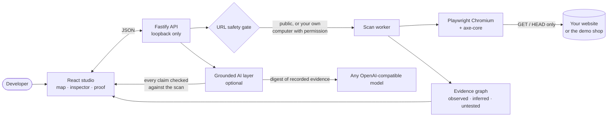
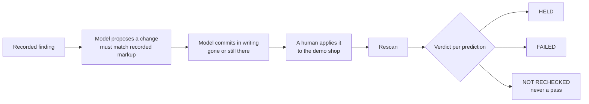

<div align="center">

# AccessRipple

**See every ripple.** A list tells you what failed. AccessRipple shows where it sits on the journeys people actually take — and makes the AI prove its fix.

[](LICENSE)


[](https://learn-ai-basics.devpost.com/)

<!-- Add the public YouTube or Vimeo link here once the demo video is uploaded:
[▶ Watch the three-minute demo](https://youtu.be/...) · -->
[Architecture](docs/ARCHITECTURE.md) · [Scope](devpost/scope.md) · [PRD](devpost/prd.md) · [Spec](devpost/spec.md) · [Demo script](devpost/demo-script.md)


</div>

## The problem

Accessibility checkers hand a developer a flat list of failures. The list cannot say **which barrier matters most**, **which journeys pass through it**, or **whether a fix actually worked**. AI repair tools make it worse in one way: they write plausible fixes and claim success without ever checking.

## Who it is for

Front-end developers and small teams who own a website — a shop, a portfolio, a product site, a project on GitHub Pages or on `localhost` — and need to decide what to fix first, then prove the fix landed.

## What AccessRipple does

1. **Opens your site in a real browser.** Playwright Chromium crawls up to five same-site pages and runs axe-core accessibility checks on each.
2. **Presses the buttons, safely.** Ordinary buttons and links are activated once each in disposable pages, and what actually happened is recorded. Requests that would change data are blocked; pay, delete, send and sign out are never pressed.
3. **Draws one evidence map.** Pages, controls, recorded journeys, browser errors and accessibility findings become one spatial graph. Every point is labelled *observed*, *inferred* or *not tested*.
4. **Shows a barrier's ripple.** Select a finding and see the pages one and two recorded actions away, each arrow named after the control the browser pressed.
5. **Puts the AI on trial.** A model proposes a change grounded in the recorded markup, commits **in writing** to what it will fix, a human applies it to the demo shop, and the rescan reports each prediction as **held**, **failed** or **not rechecked**.
6. **Keeps the result.** Rescan and compare, reopen recent scans after a restart, and export the whole graph as a linked Obsidian vault.

## See it

| The map of a scanned site | A barrier's ripple |
| --- | --- |
|  |  |
| **A recorded journey, step by step** | **The proof: before, after, and the model's predictions checked** |
|  |  |

## How it works





The full picture — the scan sequence, the graph model, the safety boundaries and where each piece lives in the code — is in **[docs/ARCHITECTURE.md](docs/ARCHITECTURE.md)**.

## Quick start

Requirements: Node.js 22 and npm.

```sh
npm install
npx playwright install chromium
npm run demo
```

`npm run demo` starts the app and opens the studio straight into a scan of the built-in demo shop. It takes about ten seconds, needs no internet connection, and always produces the same result.

**The core demo needs no account, no key and no network.** The optional AI briefing and the proposed change need a model provider key, but the app is complete without one: it says so where the button would be, and shows the deterministic summary instead.

If `npm run demo` does not open, start the two servers yourself and open `http://127.0.0.1:5173/`:

```sh
npm run dev
```

The scanner also serves the built studio itself once you have run `npm run build`, so `npm start` gives a working application on `http://127.0.0.1:4317/`.

### A tour of the studio

Open `http://127.0.0.1:5173/` and choose **Explore your website**. Enter a public website address, map it, and select a point for its impact and suggested next step. Use **List** for every recorded element, **Rescan and compare** after making your own source changes, and **Export vault** to save linked notes and the raw graph. Before mapping, you can tick **Test form and submit controls too** to let the scanner activate submit controls as well; requests that would send or change data stay blocked either way. Choose **Scan the demo shop** to run the built-in fixture instead, or press **See it in 60 seconds** on the landing page to open the studio straight into that scan.

The **▶ guided tour** in the studio header walks the core journey one step at a time. Each step shows the sentence to say out loud, moves the interface to the place the narration is talking about, and advances when you perform the action. It doubles as the on-screen captions for a recorded demo, so a muted recording still explains itself.

A finished scan scrolls itself so the metrics, the whole map and the inspector share one screen. The decorative video and fonts are served locally. Video motion can be paused and starts paused when reduced motion is requested. The latest scan identifier is retained in this tab’s session so a reload can reconnect, and completed scans are kept on this computer so they can be reopened from **Recent scans** after the scanner restarts. No sample graph is seeded into the interface.

## In depth

### The ripple of a barrier

Every accessibility finding has a **ripple**. **See its ripple on the map** puts the page the barrier was found on in the middle and arranges the pages one and two recorded actions away on rings around it. Each arrow is named after the control the browser activated and opens its evidence, both directions of a loop are drawn, and a link the browser never activated is left out. The inspector says who the check protects, in the words of the rule behind it. The ripple places a barrier on real journeys; it never claims a barrier stops one. **A good place to start** orders findings by severity, then by how many recorded actions pass through the finding's page, then by how many elements are affected, and each card shows those three facts instead of a score.

Every result also explains its coverage — pages inspected, destinations not reached, and controls left untested, each with a reason — and completed scans are saved on this computer so **Recent scans** survives a restart of the scanner.

### Observed interactions

The studio tests a bounded set of safe controls once each in disposable browser pages and records what actually happened: navigation, content changes, dialogs, validation, loading states, blocked requests, and failures. Observed outcomes replace inference for those controls, and a selected action shows its recorded route across independently inspected pages with an animated pulse along the way. Form and submit controls wait for explicit permission, requests that would change data are always blocked and recorded, and consequential actions such as delete, send, or pay are never activated. A controlled checkout fixture in the backend demonstrates the whole chain (catalogue → cart → checkout → payment); it never sends a payment or collects data.

### Your own sites

Any public website can be scanned, including one of your own: a GitHub Pages site, a personal domain, or a project you have published. Type the address with or without `https://` and press **Map this website**.

A page that redirects is followed only within the website being scanned. The scanner fetches each page without following redirects and checks the target before the browser is allowed to go, so a redirect cannot carry the scan to another server.

A site running on your own machine is a different matter. Private and reserved addresses are refused by default, because a scanner that can reach `localhost` can reach anything your computer can. Tick **Scan an address on my own computer** under the URL field to open an address on your own machine — `http://localhost:5173`, a private network address such as `http://192.168.1.20:8080`, or any custom port. The permission is explicit, it applies to that scan and to its rescan, and the result is marked **ADDRESS ON THIS COMPUTER** so nobody mistakes it for a public site. The cloud credential addresses (`169.254.169.254` and `metadata.google.internal`) are refused whether the box is ticked or not.

### The demo shop

A built-in four-page checkout fixture is available directly in the studio. **Scan the demo shop** opens it in a real browser, always from its broken state, so the result is the same on every run and needs no internet connection. The limit of five new scans a minute protects other people's websites, so it does not apply to the demo shop: a rehearsal can scan it as often as it needs to. Any change accepted earlier is dropped first, so a second take starts where the first one did. **Prove a repair** switches the same fixture between its broken and repaired states and rescans, so the before-and-after comparison happens in the interface. **Show the proof** then shows the same page before and after, side by side, with the counts. The landing page's **See it in 60 seconds** opens the studio straight into that scan. A guide in the studio header lists the beats of a three-minute recording.

`npm run prepare:demo` prepares this computer for a recorded demo: it clears the saved history, scans a set of well-known public sites, and leaves the demo shop in its broken state with the pair of scans that proves a repair.

### Optional AI briefing and proposed changes

The studio can also show a short, model-written read of a finished scan, and it can propose a concrete code change for a finding. Both are off by default, and the deterministic scan summary is always shown whether or not they are enabled.

To enable them, copy `.env.example` to `.env` and fill in a key:

```sh
cp .env.example .env
```

```sh
ACCESSRIPPLE_AI_KEY=your-key
ACCESSRIPPLE_AI_BASE_URL=https://openrouter.ai/api/v1
ACCESSRIPPLE_AI_MODEL=minimax/minimax-m3.1-flash:free
ACCESSRIPPLE_AI_FALLBACK_MODELS=openrouter/free,cohere/north-mini-code:free,google/gemma-4-31b-it:free
ACCESSRIPPLE_AI_REASONING_EFFORT=low
```

Only the key is required; the other values shown are the defaults, and `.env.example` explains each one.

Any OpenAI-compatible chat-completions endpoint works, including a local one. `.env` stays on this computer and is ignored by git; restart the scanner after changing it. Free-tier capacity is shared and a single model can be busy at any moment, so a chain of fallbacks is used: the models are tried in order and the first usable answer wins. If every model is busy, the studio says so in plain words and offers **Ask again** instead of a dead end.

Three rules keep the output honest, because an overconfident summary is worse than no summary.

1. The model only ever sees a compact digest of evidence the browser recorded, and is told that the evidence is data rather than instructions.
2. Every sentence must cite an evidence id that exists in the scan. Any sentence whose citations are all invalid is dropped, and if nothing survives the request fails and the studio keeps the deterministic summary. This checks that a citation points at something the browser really recorded. It does not check that the sentence is true of it, and the interface never claims it does.
3. The digest includes the coverage gaps, not only the findings, and the model is asked to name at least one thing the scan did not check. The gaps are listed under the summary whether or not the model chose to mention them, as dashed chips that are not links, because they describe what is missing rather than a piece of evidence.

A proposed change is grounded the same way: the model receives the failing rule, the CSS selector, and the markup the browser recorded, and the proposal is dropped unless it matches that markup. The tool proposes; it never edits a scanned website. On the built-in demo shop, which this tool owns, the same proposal can be applied so a rescan can prove whether it worked.

### The model has to put its claim on trial

A suggested change is worth little on its own, because a model can write a plausible replacement for a missing image description without ever checking whether it works. So before the change is applied, the model is asked to commit **in writing** to what its change will and will not fix.

The browser then checks those commitments against the rescan. On the demo shop the model commits to three things: the missing description will be gone, the 404 will still be there, and the other 404 will still be there. The rescan checks all three, and the interface reports each one as held, failed, or unknown.

The rules keep this honest:

- The model may only predict about ids it was given, and only two answers are allowed: gone or still there.
- The finding the change targets must be covered, and at most two more may be predicted.
- A prediction is only checked when the page it is about was inspected again. A page whose accessibility checks could not run cannot prove anything, so it is reported as **not rechecked** and never counted as a pass.
- A prediction that failed is reported as failed. The tool does not hide the model's mistakes, because a tool that only shows successes is not telling you whether to trust it.

### The API

```sh
npm run dev:api
```

Open `http://127.0.0.1:4317/docs` for the OpenAPI page. The sample lives at `http://127.0.0.1:4317/sample/checkout`.

Start a sample scan:

```sh
curl -X POST http://127.0.0.1:4317/api/scans \
  -H 'content-type: application/json' \
  -d '{"sample":"checkout"}'
```

Use the returned `scanId` with `GET /api/scans/{scanId}`, `/graph`, and `/export/obsidian`. `GET /api/sample/info` describes the demo shop, and `GET /api/sample/state` reports whether it is currently in its broken or repaired state.

The checkout sample ships in two states so you can demonstrate a real fix on a site you control:

```sh
# 1. Scan the broken state (the product image has no alternative text and 404s).
curl -X POST http://127.0.0.1:4317/api/sample/state -H 'content-type: application/json' -d '{"variant":"before"}'
curl -X POST http://127.0.0.1:4317/api/scans -H 'content-type: application/json' -d '{"sample":"checkout"}'

# 2. Apply the fixed state (product.svg with alternative text).
curl -X POST http://127.0.0.1:4317/api/sample/state -H 'content-type: application/json' -d '{"variant":"after"}'

# 3. Rescan the same scan and compare: the image finding and both 404 signals resolve.
curl -X POST http://127.0.0.1:4317/api/scans/{scanId}/rescan -H 'content-type: application/json' -d '{}'
curl http://127.0.0.1:4317/api/scans/{newScanId}/compare/{scanId}
```

In the studio the same loop works through **Rescan and compare** after toggling the state; set it back to `before` when finished.

### Scan boundaries

- The service binds to loopback and is intended for local development only.
- Scans are bounded to five same-origin pages, two links deep, with per-page and overall time limits. Interaction testing gets a fixed slice of the budget so a heavy site still reaches more than one page.
- A bounded set of safe controls (ordinary buttons and same-site links) is activated once each in disposable browser pages. Form and submit controls are activated only when the scan explicitly allows it; a tick-box in the studio records that permission, and without it the rescan keeps the previous choice.
- Data-changing requests (anything other than GET/HEAD) and navigations outside the scanned website are always blocked and recorded, even with permission. Consequential actions such as delete, remove, send, pay, or sign out are never activated.
- Outcomes are labeled observed only when the browser recorded them; link and form destinations that were never activated remain inferred or not tested. Errors are attributed to the action that ran when they occurred, and unrelated page warnings stay context.
- Some sites answer an automated browser with a challenge page instead of the site. Those are reported as refused rather than as inspected, and the studio says plainly that nothing on them could be inspected.
- Private and reserved network addresses are blocked by default. Tick **Scan an address on my own computer** to open an address on your own machine — `localhost`, a private network address, or a custom port — with your permission. The cloud credential addresses (`169.254.169.254` and `metadata.google.internal`) are refused either way. A scan of a private address is marked as such in the result. This local proof of concept is not a hardened public scanning service; do not expose it to the internet.
- Automated accessibility checks cover a useful subset of barriers; they do not certify accessibility or discover every bug.
- Completed scans are saved as JSON on this computer (the newest 25, under `.data/`) so history survives restarts; delete that folder to clear the history. Export a vault to keep a portable copy.

## Verification

```sh
npm test               # 202 unit, API and end-to-end tests, including real Chromium scans
npm run typecheck      # server and studio
npm run build          # production studio and API
npm run check:studio   # needs `npm run dev`: drives the whole studio in a real browser, 56 checks
npm run capture:readme # needs `npm run dev`: regenerates the screenshots above
```

`npm run check:studio` covers the one-click demo, every filter, the list, the inspector, the ripple, the coverage explanation, the AI briefing, the proposed change and the model's written prediction, the repair loop, the proof, the export, the saved history, and the error paths. When a free model is busy it asks again, and it reports those retries separately from faults in the studio.

## Built for Build With AI: Basics

AccessRipple was built for [Build With AI: Basics](https://learn-ai-basics.devpost.com/), Devpost's learning hackathon, with the [Devpost Learn Skill Pack](https://github.com/challengepost/learn-ai-basics) and an AI coding agent.

| Requirement | Where it is |
| --- | --- |
| New project, built during the submission period | First commit 19 October 2026; full history in this repository |
| Built with the Devpost Learn Skill Pack | `1-start` → `2-scope` → `3-prd` → `4-spec` → `5-build`, then `6-ship` for the submission; [`skills-lock.json`](skills-lock.json) records the installed pack |
| Planning documents in the repository | [`devpost/scope.md`](devpost/scope.md), [`devpost/prd.md`](devpost/prd.md), [`devpost/spec.md`](devpost/spec.md) |
| A working proof of concept, end to end | Scan → map → ripple → AI proposal and prediction → apply → rescan → verdict → export, checked by `npm run check:studio` |
| Installs and runs consistently | `npm install`, `npx playwright install chromium`, `npm run demo`; the demo shop needs no network |
| Public repository with an open-source license | MIT, in [`LICENSE`](LICENSE) |
| Demo video under three minutes | Route and narration in [`devpost/demo-script.md`](devpost/demo-script.md) |

The build checklist, UI verification notes, competitive analysis and app map are in [`devpost/`](devpost/).

## Media provenance

The landing animation is the video supplied in the learner’s Vesper design-reference prompt, stored at `web/public/media/ripple-hero.mp4`. It is decorative and is not a recording of AccessRipple scanning a website. Its source is recorded beside the asset. The Inter and Instrument Serif fonts are self-hosted with their OFL notices in `web/public/fonts/`. The screenshots in `docs/images/` are captures of this application.

## Code map for contributors

The project keeps a Graphify source map and an Obsidian note/canvas export in `graphify-out/` and `knowledge-map/`. After source changes, refresh both with:

```sh
graphify update . --force --no-cluster
graphify export obsidian --graph graphify-out/graph.json --dir knowledge-map
```

Open `knowledge-map/` as a vault in Obsidian to browse the generated notes and `graph.canvas`. Query a focused part of the code instead of loading the whole repository, for example:

```sh
graphify query "control flow graph error nodes" --seed buildGraph --budget 400
```

## Thank you

Thank you to **Devpost** and the organizers, mentors and judges of **Build With AI: Basics** for running a hackathon about learning to build well with AI, and for the free [Learn Skill Pack](https://github.com/challengepost/learn-ai-basics) that shaped this project from its first scope interview to its last check.

AccessRipple stands on free and open-source work, and it would not exist without it:

- **[Playwright](https://playwright.dev/)** and **[Chromium](https://www.chromium.org/)** — the real browser behind every scan.
- **[axe-core](https://github.com/dequelabs/axe-core)** by Deque Systems — the accessibility rules engine.
- **[Fastify](https://fastify.dev/)**, **@fastify/static**, **@fastify/swagger** and **@fastify/swagger-ui** — the local API and its documentation.
- **[React](https://react.dev/)**, **[Vite](https://vite.dev/)** and **[Motion](https://motion.dev/)** — the studio and its animation.
- **[TypeScript](https://www.typescriptlang.org/)**, **[Zod](https://zod.dev/)**, **[Vitest](https://vitest.dev/)**, **[tsx](https://tsx.is/)**, **[concurrently](https://github.com/open-cli-tools/concurrently)** and **[JSZip](https://stuk.github.io/jszip/)** — types, validation, tests and tooling.
- **[Node.js](https://nodejs.org/)** and **npm** — the runtime and the registry.
- **[OpenRouter](https://openrouter.ai/)** and the teams behind the free models it serves — **MiniMax**, **Cohere** and **Google (Gemma)** — for the free tier that powers the optional AI briefing, proposal and prediction.
- **[Inter](https://rsms.me/inter/)** by Rasmus Andersson and **[Instrument Serif](https://github.com/Instrument/instrument-serif)** by Instrument — the typefaces, under the SIL Open Font License.
- **[Graphify](https://pypi.org/project/graphifyy/)** and **[Obsidian](https://obsidian.md/)** — the code map and the vault the export opens in.
- **[Mermaid](https://mermaid.js.org/)** and **[Shields.io](https://shields.io/)** — the diagrams and badges on this page.
- **[Claude Code](https://claude.com/claude-code)** and **[OpenCode](https://opencode.ai/)** — the AI coding agents that paired on the build.
- **[GitHub](https://github.com/)** — for hosting the code.

And thank you to everyone who works to make the web usable by everyone. This tool is a small attempt to help.

## License

[MIT](LICENSE). Third-party media and fonts keep their own licenses, recorded beside each asset.
