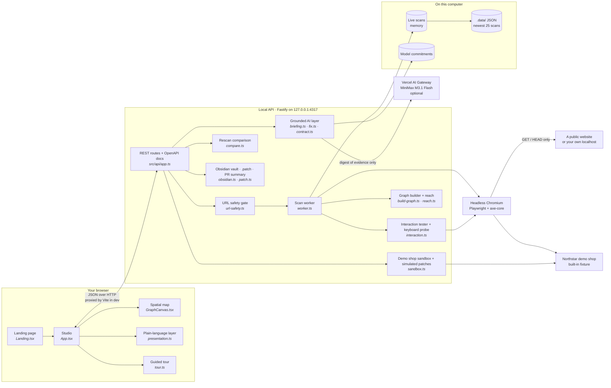
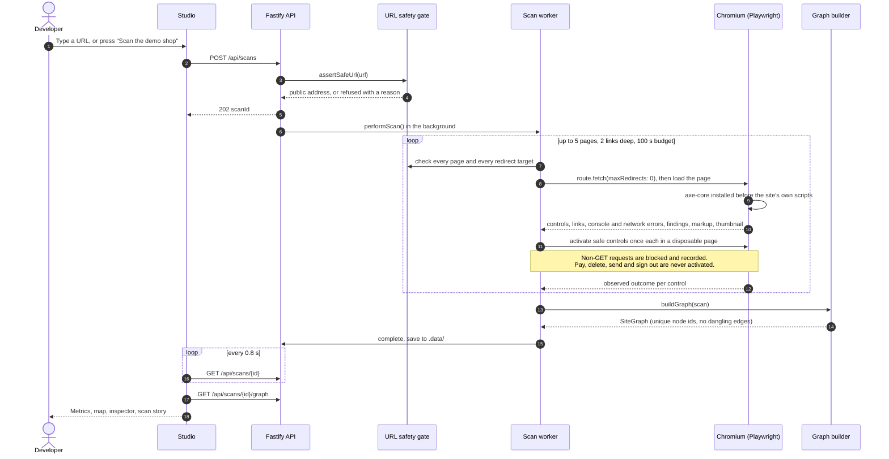
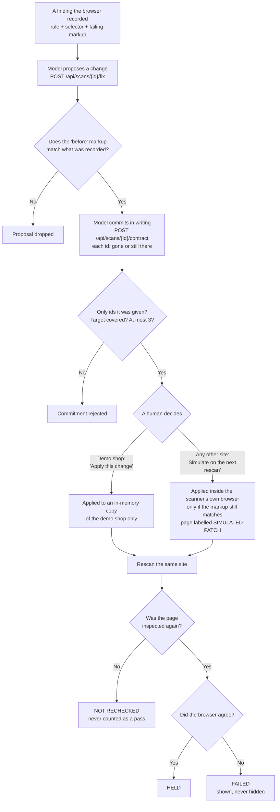
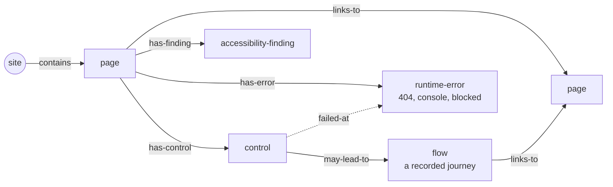
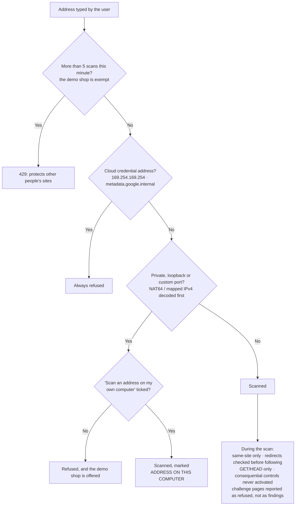

# AccessRipple architecture

AccessRipple is two processes on one computer: a React studio in the browser and a local Fastify API that drives a real Chromium. Everything the studio shows is evidence the browser recorded; the optional model only ever reads that evidence and is checked against it.

## 1. The system at a glance

| Layer | Technology | Responsibility |
| --- | --- | --- |
| Studio | React 19, Vite 8, Motion, hand-built SVG | Landing, scan bar, spatial map, inspector, list, proof, guided tour |
| API | Fastify 5, Zod, `@fastify/swagger` | Validates input, rate-limits public scans, serves the demo shop and OpenAPI docs |
| Scanner | Playwright Chromium, axe-core 4 | Crawls up to five same-site pages, runs accessibility checks, activates safe controls |
| Graph | Pure TypeScript | Turns scan evidence into nodes and edges, each labelled observed, inferred or untested |
| AI | `fetch` to the Vercel AI Gateway, or any chat-completions endpoint | Briefing, proposed change and written prediction, each grounded in recorded evidence |
| Storage | In-memory map + JSON files | Recent scans survive a restart; nothing leaves the computer except the scan itself and the optional model digest |

## 2. One scan, end to end

## 3. The model has to put its claim on trial

This is the loop that makes the AI accountable. The model proposes, commits in writing, a human decides, and the browser delivers the verdict.

The briefing follows the same rule: every sentence must cite an evidence id that exists in the scan, sentences with no valid citation are dropped, and a briefing with nothing grounded left is refused rather than shown.

## 4. What a scan becomes

Every node and edge carries an evidence label:

- **observed** — the browser did it and recorded the outcome.
- **inferred** — the markup suggests it, but nothing was activated.
- **untested** — out of budget, needs permission, or deliberately never activated.

The ripple of a barrier uses only observed page-to-page steps, rings pages by recorded-action distance, and never claims a barrier stops a journey.

## 5. Safety boundaries

## 6. Where to look in the code

| Question | Start here |
| --- | --- |
| How is a page crawled and checked? | `src/scan/worker.ts` → `performScan` |
| Which controls are clicked, and which never are? | `src/scan/interaction.ts` → `classifyAction`, `runInteractions` |
| Why was an address refused? | `src/scan/url-safety.ts` → `assertSafeUrl`, `isPublicIp` |
| How does evidence become a map? | `src/graph/build-graph.ts` → `buildGraph` |
| How is a rescan compared? | `src/graph/compare.ts` → `compareScans` |
| How is the model kept honest? | `src/ai/briefing.ts`, `src/ai/fix.ts`, `src/ai/contract.ts` |
| How is the plain-language copy written? | `web/src/presentation.ts` (`scanStory`, `barrierRipple`, `traceJourney`) |
| How is the map drawn? | `web/src/GraphCanvas.tsx`, `web/src/graph-explorer.ts` |

## 7. How it is verified

| Command | What it proves |
| --- | --- |
| `npm test` | 231 unit, API and end-to-end tests across 25 files, including real Chromium scans of the demo shop |
| `npm run typecheck` | Server and studio both type-check under TypeScript 7 |
| `npm run build` | The production studio builds and the API compiles |
| `npm run check:studio` | Drives the whole studio in a real browser and checks 45 behaviours, plus the AI path when a model key is configured |
